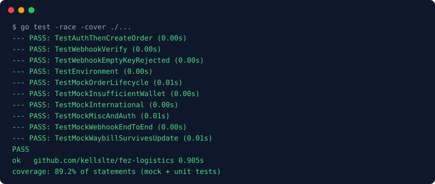
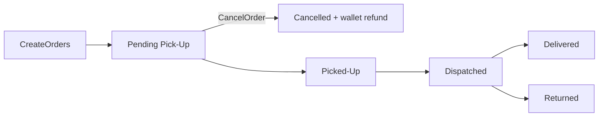

<div align="center">

# fez-logistics

**A typed, dependency-free Go client for the [Fez Delivery Business API](https://fez-delivery-co.gitbook.io/fezcorporate-api-docs)**

Local, interstate, import & export orders · pricing · tracking · lockers · users · webhooks

[](https://github.com/kellslte/fez-logistics/actions/workflows/ci.yml)
[](https://pkg.go.dev/github.com/kellslte/fez-logistics)
[](go.mod)
[](LICENSE)


</div>

---

## Contents
[Install](#install) · [Quick start](#quick-start) · [Environments](#environments) · [**Verified API behaviour**](#verified-api-behaviour-read-this-first) · [Orders](#orders) · [Webhooks](#webhooks) · [Errors](#errors) · [Endpoint coverage](#endpoint-coverage) · [Test status](#test-status) · [Releasing](#releasing) · [Notes for AI assistants](#notes-for-ai-assistants)

## Install

```sh
go get github.com/kellslte/fez-logistics@latest
```

```go
import fez "github.com/kellslte/fez-logistics"
```

Requires Go 1.21+. Standard library only.

## Quick start

```go
ctx := context.Background()
c := fez.New(fez.WithEnvironment(fez.Sandbox)) // Sandbox is the default

// One login stores the bearer token, the secret key and your internal user id.
if _, err := c.Authenticate(ctx, os.Getenv("FEZ_USER_ID"), os.Getenv("FEZ_PASSWORD")); err != nil {
    log.Fatal(err)
}

quote, _ := c.DeliveryCost(ctx, fez.CostRequest{State: "FCT", PickUpState: "Lagos", Weight: 1})
fmt.Println("total:", quote.TotalCost) // cost + VAT + surcharge — what you are charged

res, err := c.CreateOrders(ctx, []fez.CreateOrder{{
    RecipientName:    "Ada Okafor",           // ≥ 5 characters
    RecipientPhone:   "08012345678",
    RecipientAddress: "5 Aminu Kano Crescent, Wuse 2",
    RecipientState:   "FCT",
    PickUpState:      "Lagos",
    UniqueID:         "shop-order-1042",      // your id; must be unique
    BatchID:          "batch-2026-11-24",
    ValueOfItem:      "15000",
    Weight:           1,
    WaybillNumber:    "WB-1042",              // optional, your own reference
}})
if err != nil {
    log.Fatal(err) // see "Errors" — res.OrderNos holds per-order reasons
}
orderNo := res.OrderNos["shop-order-1042"] // store this: it is your source of truth

tr, _ := c.TrackOrder(ctx, orderNo)
fmt.Println(tr.Order.OrderStatus)
```

<p align="center"></p>

## Environments

| Constant | Base URL | Notes |
|---|---|---|
| `fez.Sandbox` *(default)* | `https://apisandbox.fezdelivery.co/v1` | Fake money, safe to experiment |
| `fez.Production` | `https://api.fezdelivery.co/v1` | **Real wallet charges and real riders** |

```go
env, err := fez.ParseEnvironment(os.Getenv("FEZ_ENV")) // sandbox|production (also dev, prod, live, test)
c := fez.New(fez.WithEnvironment(env))
```

| Option | Purpose |
|---|---|
| `WithEnvironment(env)` | Pick sandbox or production. An unknown value makes **every call fail** — it never silently falls back. |
| `WithBaseURL(url)` | Override the URL (proxy, test server). Wins over `WithEnvironment` in any order. |
| `WithHTTPClient(hc)` | Custom `*http.Client` (default timeout 30s). |
| `WithCredentials(token, secret)` | Reuse a stored token. Tokens expire — see `c.TokenExpiry()`. |
| `WithAutoLogin(userID, password)` | Give credentials up front: the client logs in on first use, so no `Authenticate` call is needed. These credentials survive `Logout`. |
| `WithoutAutoLogin()` | Opt out of automatic re-login. The password is never kept in memory, and expired tokens return `401`. |

### Sessions

Fez has no refresh token. A session is renewed by calling `/user/authenticate` again (confirmed by Fez support), which is limited to **60 requests/minute**. `/user/logout` invalidates the active token.

**Sessions renew automatically by default.** After a successful `Authenticate`, the client keeps the login in memory. When a call gets `401` (expired token), it logs in again once and retries the call. Concurrent 401s share one login.

```go
c := fez.New(fez.WithEnvironment(fez.Production))
c.Authenticate(ctx, os.Getenv("FEZ_USER_ID"), os.Getenv("FEZ_PASSWORD"))
// Hours later: the expired token is renewed transparently.
res, err := c.CreateOrders(ctx, orders)

// Or skip Authenticate entirely:
c = fez.New(fez.WithAutoLogin(os.Getenv("FEZ_USER_ID"), os.Getenv("FEZ_PASSWORD")))
```

| Event | Effect on the stored login |
|---|---|
| Failed `Authenticate` | Nothing is stored |
| `ChangePassword` for your own user | Stored password updated to the new one |
| `Logout` | Token dropped. Credentials remembered from `Authenticate` are forgotten, so later calls return `401` until you log in again. `WithAutoLogin` credentials are kept. |
| `WithoutAutoLogin()` | Nothing is stored. Handle `401 Invalid session` yourself. |

Use one long-lived `*Client` per credential set. Building a new client per request logs in every time and can hit the rate limit.

> Sandbox and production credentials are **separate**. Authenticate again after changing environment.

## Verified API behaviour (read this first)

Everything below was observed against the **real sandbox** and in several places **differs from Fez's published docs**. The SDK already handles each one; you need to know them when designing your integration.

| # | Behaviour | What the SDK does | What you should do |
|---|---|---|---|
| 1 | `PUT /order` accepts **one** order object. The documented array form (and `/order/multiple`) is rejected with *"The order no field is required"*. | `UpdateOrders` sends one request per order and reports each result. | Prefer `UpdateOrder` / `UpdateOrderKeepWaybill`. |
| 2 | A successful update **without** `WaybillNumber` **clears the order's waybill**. Re-sending the unchanged waybill in the same request fails with *"The waybill number has already been taken"*. A different value, or the same value in a follow-up request, works. | `UpdateOrderKeepWaybill` updates, then re-attaches the waybill. | Always use `UpdateOrderKeepWaybill(ctx, upd, currentWaybill)` when a waybill matters. Retry if the second step errors (the order is then temporarily waybill-less). |
| 3 | `GET /orders/{orderNo}` **never returns the waybill**. Lookup only works the other way round (`SearchByWaybill` → order number). | — | **Store the Fez order number as the source of truth** and keep your own copy of the waybill. |
| 4 | `Logout` / `ChangePassword` need the **internal user id** (`G-xxxx-xxxx`) returned by `Authenticate`, not your login email. | `Authenticate` stores it; pass `""` to use it. | `c.Logout(ctx, "")` |
| 5 | `/states` needs no credentials; everything else needs **both** `Authorization: Bearer …` and `secret-key`. | Both headers are set automatically. | — |
| 6 | `recipientName` must be **≥ 5 characters** (also on update). | Server validation error surfaces as `*APIError`. | Validate in your UI. |
| 7 | Failed order creation returns **HTTP 400** with per-order reasons in `orderNos` (e.g. *"Insufficient wallet balance"*) plus `duplicateUniqueIds`. | Create calls return **both** the response and the `*APIError`. | Inspect `res.OrderNos` on error. |
| 8 | Import location **1 (Niger)** has no price → *"Price not available at this time"*. Other locations work. | — | Call `ImportDeliveryCost` first; hide unpriced locations. |
| 9 | International orders cost far more than local ones (sandbox: export ≈ ₦75,800, local Lagos ≈ ₦1,762). | — | Make sure the wallet covers export orders before creating them. As of 25 Nov 2026 the sandbox rejects export creation with *"Export order creation is currently unavailable."* (per order, HTTP 400). |
| 10 | `DeliveryCost` returns `cost` **and** `Cost` (same data) plus `vat`, `surcharge`, `totalCost`. The amount charged is `totalCost`. | `CostResponse.TotalCost`, `StateCost()` helper. | Show `TotalCost` to customers, not `cost`. |
| 11 | `DeliveryTimeEstimate` works with params in the query string **and** body; `ExportDeliveryCost` is documented as GET with a body. | Both are sent in query + body. | — |
| 12 | `ManifestURL` returns 404 *"Manifest is not available"* until Fez generates one. | Returned as `*APIError`. | Treat 404 as "not yet". |
| 13 | Orders can only be cancelled while `Pending Pick-Up`, `Pending Payment`, `Pending Drop-off`, `Dropped-off`, `Rejected At Drop-off` or `Failed Pick-Up`. Cancelling refunds the business wallet, **in full only before pick-up** (see [Billing](#billing)). | `CancelOrder` | Handle the 400 for later statuses. |
| 14 | **The webhook URL shown on the dashboard is separate from the one `RegisterWebhook` sets.** After a successful API registration the sandbox dashboard still showed the old URL. | — | Set and confirm the URL **in the dashboard**; treat `RegisterWebhook` as unproven until a delivery is seen. |
| 15 | Money and weight fields arrive as strings **or** numbers. | `fez.Number` (= `json.Number`) decodes both. | Use `.String()`/`.Float64()`. |

### Not yet verified against real Fez traffic

| Area | Risk |
|---|---|
| **Webhook delivery & `X-Signature`** | Assumed `HMAC-SHA256(secretKey, orderNo + status + timestamp)`, hex. Fez's docs only say "SHA256 … signed with the secret key". If real deliveries fail verification, capture one request and adjust `Sign`. **Until confirmed, poll `TrackOrder` as a fallback.** |
| Production | No production calls have been made by the test-suite. |
| `ChangePassword` | Mock-tested only (it would change the sandbox password). |
| `ManifestURL` success body | Only the 404 path was seen live. |

## Billing

Confirmed by Fez support (November 2026):

- **Orders are paid from the business wallet.** The delivery cost is deducted **when the order is created**. If the wallet is short, `CreateOrders` fails for that order with *"Insufficient wallet balance"*.
- **The API cannot take payments.** There is no endpoint to pay for an order, fund the wallet or read its balance. Fund the wallet in the [Fez Business Portal](https://businessportal.fezdelivery.co).
- **Pay Later** (monthly invoicing on an agreed billing cycle) is the only alternative to a funded wallet. Fez's Business team must approve it per organisation. The API calls stay the same.
- **`Pending Payment` / `paymentStatus: "unpaid"`** means the order was created but payment did not complete. It can only be retried from the Business Portal dashboard, not through the API. It can still be cancelled with `CancelOrder`.
- **Refunds on cancellation** depend on the delivery stage:

| Stage when cancelled | Refund to wallet |
|---|---|
| Not yet picked up | 100% |
| Picked up, delivery not yet attempted | 50% |
| Delivery already attempted | None |

## Orders

### Lifecycle



### Updating safely

```go
// Order number is the source of truth; the waybill is re-attached for you.
err := c.UpdateOrderKeepWaybill(ctx,
    fez.UpdateOrder{OrderNo: orderNo, RecipientName: "Ada N. Okafor", RecipientPhone: "08087654321"},
    "WB-1042", // the waybill currently on the order (from your database)
)

// Changing the waybill itself is a single request:
err = c.UpdateOrderKeepWaybill(ctx, fez.UpdateOrder{OrderNo: orderNo, WaybillNumber: "WB-1042-R"}, "WB-1042")
```

### Searching

```go
page, _ := c.SearchOrders(ctx, fez.SearchOrders{StartDate: "2026-11-01", EndDate: "2026-11-30", Page: 1})
for _, o := range page.Orders.Data { fmt.Println(o.OrderNo, o.OrderStatus) } // 50 per page; see Orders.LastPage
```

### International

```go
locs, _ := c.ExportLocations(ctx)                      // ids + weights
cost, _ := c.ExportDeliveryCost(ctx, fez.ExportCostRequest{WeightID: 1, ExportLocationID: locs.Data.ExportLocations[0].ID})
_, err := c.CreateExportOrders(ctx, []fez.ExportOrder{{ /* … */ ExportLocationID: 1 }})
// Imports: ImportLocations, ImportItemCategories, ImportDeliveryCost, CreateImportOrders
```

## Webhooks

```go
// 1. Register your public HTTPS URL (replaces any previous webhook; there is no read/delete API)
c.RegisterWebhook(ctx, "https://shop.example.com/hooks/fez")

// 2. Serve it. WebhookHandler verifies the signature, rejects timestamps older
//    than 5 minutes (replay protection) and panics at start-up on an empty key.
http.Handle("/hooks/fez", fez.WebhookHandler(secretKey, func(ev fez.WebhookEvent) {
    // ev.OrderNumber, ev.Status — make this idempotent; Fez may retry
}))
```

The secret key is the value in your dashboard (*Developers → Manage Keys*), identical to the one `Authenticate` returns. See [verification status](#not-yet-verified-against-real-fez-traffic).

## Errors

All failures from the API are `*fez.APIError`:

```go
var ae *fez.APIError
if errors.As(err, &ae) {
    log.Println(ae.HTTPStatus, ae.Description, ae.Body) // Body is the raw response
}
```

| HTTP | Typical `Description` | Meaning |
|---|---|---|
| 401 | `Organization Secret Key is Required` | Missing `secret-key` |
| 401 | `Invalid session` | Missing/expired/logged-out token → renewed automatically after `Authenticate`/`WithAutoLogin`. You only see it after `Logout`, with `WithoutAutoLogin`, or if re-login fails. |
| 400 | `Error creating orders` | See `res.OrderNos[uniqueID]`, e.g. `Insufficient wallet balance…` → fund the wallet in the Business Portal |
| 400 | `The … field …` | Validation (name length, taken waybill, …) |
| 404 | `Order not found.` / `Price not available at this time` | Unknown id / unpriced route |
| 422 | `The … field is required.` | Missing field |

## Endpoint coverage

All **30** documented endpoints plus the inbound webhook. ✅ = exercised against the real sandbox · 🧪 = covered by the mock server only.

| Area | Method | Endpoint | Go method | |
|---|---|---|---|:-:|
| Auth | POST | `/user/authenticate` | `Authenticate` | ✅ |
| | POST | `/user/logout` | `Logout` | ✅ |
| | POST | `/user/changePassword` | `ChangePassword` | 🧪 |
| Orders | POST | `/order` | `CreateOrders` | ✅ |
| | PUT | `/order` | `UpdateOrder`, `UpdateOrders`, `UpdateOrderKeepWaybill` | ✅ |
| | DELETE | `/order` | `DeleteOrder` | ✅ |
| | POST | `/order/cancel` | `CancelOrder` | ✅ |
| | GET | `/orders/{orderNo}` | `GetOrder` | ✅ |
| | GET | `/orders/{orderNo}/manifest-url` | `ManifestURL` | 🧪 |
| | POST | `/orders/search` | `SearchOrders` | ✅ |
| | GET | `/orders/search/{waybill}` | `SearchByWaybill` | ✅ |
| | POST | `/orders/statsWithDateRange` | `OrderStats` | ✅ |
| | GET | `/order/track/{orderNo}` | `TrackOrder` | ✅ |
| | POST | `/order/cost` | `DeliveryCost` | ✅ |
| | POST | `/delivery-time-estimate` | `DeliveryTimeEstimate` | ✅ |
| | GET | `/states` | `States` | ✅ |
| | GET | `/hubs/{stateId}` | `Hubs` | ✅ |
| International | POST | `/orders/export` | `CreateExportOrders` | ✅ |
| | POST | `/orders/import` | `CreateImportOrders` | ✅ |
| | GET | `/orders/export-price` | `ExportDeliveryCost` | ✅ |
| | POST | `/orders/import-price` | `ImportDeliveryCost` | ✅ |
| | GET | `/orders/export-locations` | `ExportLocations` | ✅ |
| | GET | `/orders/import-locations` | `ImportLocations` | ✅ |
| | GET | `/orders/item-categories` | `ImportItemCategories` | ✅ |
| Lockers | GET | `/Lockers/{state}` | `Lockers` | ✅ |
| | GET | `/LockerAvailability/{id}` | `LockerAvailable` | ✅ |
| Users | POST | `/user` | `CreateUser` | ✅ |
| | GET | `/users` | `Users` | ✅ |
| | POST | `/user/{id}/delete` | `DeleteUser` (numeric id from `Users`) | ✅ |
| Webhooks | POST | `/webhooks/store` | `RegisterWebhook` | ✅ |
| | — | inbound POST to your URL | `WebhookHandler`, `VerifyWebhook`, `Sign` | 🧪 |

## Test status

| Suite | What it proves | Runs in CI |
|---|---|:-:|
| Unit + **mock Fez server** (`mock_test.go`, `fez_test.go`) | Every endpoint's method, path, headers and JSON keys; order lifecycle; webhook round-trip incl. forged/replayed/unsigned requests; all quirks above | ✅ (`-race`) |
| Sandbox read-only (`integration_test.go`) | Real responses decode into the SDK types | ❌ needs credentials |
| Sandbox write (`integration_write_test.go`, `integration_session_test.go`) | Real create → get → track → update → cancel, interstate, import/export, users, lockers, logout, webhook registration | ❌ opt-in |

CI (`.github/workflows/ci.yml`) runs on every push/PR and weekly: `gofmt`, `go vet`, `go mod tidy` check, `go test -race` on Go 1.21 and latest × Linux and macOS, `golangci-lint`, `govulncheck`, and — on tags — that `version.go` equals the tag.

Run the live suites yourself (creates and cancels sandbox orders, spends sandbox wallet):

```sh
cp .env.example .env            # then fill in sandbox credentials
go test -run SandboxReadOnly -v ./...
FEZ_WRITE_TESTS=1 go test -run 'SandboxWrite|SandboxSession' -v ./...
```

`SandboxSession` replaces the sandbox account's webhook and logs the token out. `.env` is git-ignored; live tests only ever target the **sandbox**.

## Releasing

```sh
scripts/bump.sh patch|minor|major --push   # vet + test, update version.go, commit, tag vX.Y.Z, push
```

`fez.Version` is sent in the `User-Agent` header (`fez-logistics-go/X.Y.Z`).

## Notes for AI assistants

If you are an AI coding assistant integrating this package, follow these rules:

1. **Persist the Fez order number** (`CreateOrdersResponse.OrderNos[yourUniqueID]`) and use it for `GetOrder`, `TrackOrder`, `UpdateOrder*` and `CancelOrder`. Never rely on the waybill to find an order later.
2. **Never call `UpdateOrder` directly when a waybill is set** — use `UpdateOrderKeepWaybill`, otherwise the waybill is silently erased.
3. **Keep your own copy of the waybill**; the API will not return it.
4. Default to `fez.Sandbox`. Use `fez.Production` only when told to, and treat production calls as spending real money.
5. Always check `res.OrderNos` when `CreateOrders` errors; the reasons are per order.
6. Show customers `DeliveryCost(...).TotalCost`, not `.cost`.
7. Do not trust webhook signatures as the only signal yet (see [verification status](#not-yet-verified-against-real-fez-traffic)); reconcile with `TrackOrder`.
8. Validate `recipientName` ≥ 5 characters, and Nigerian state names against `States()`.
9. Sessions renew themselves; do not add your own re-login or retry-on-401 logic. Reuse one long-lived client, because logins are limited to 60/minute.
10. Do not build payment or wallet-funding flows on this API: none exist. On *"Insufficient wallet balance"*, tell an operator to fund the wallet in the Business Portal (or use Pay Later). `Pending Payment` orders are retried in the portal.
11. Cancellation refunds are 100% before pick-up, 50% after pick-up and before a delivery attempt, and 0% after one. Do not promise full refunds.

## License

[MIT](LICENSE)
